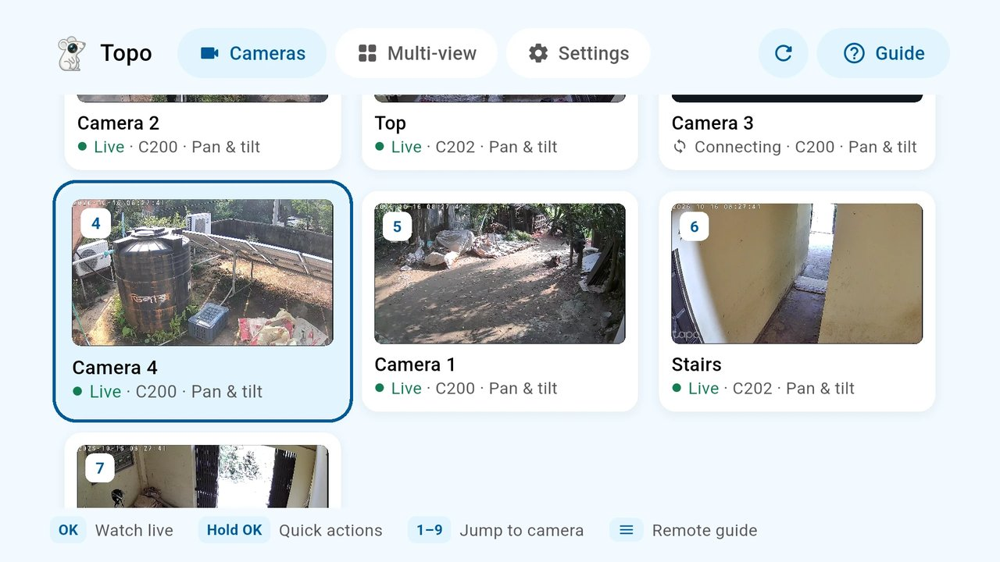
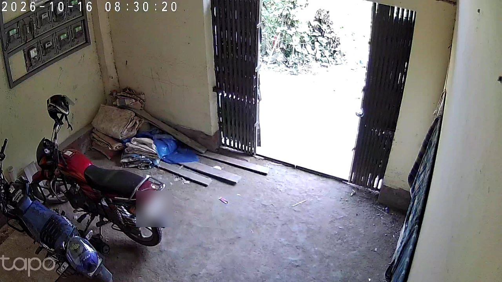
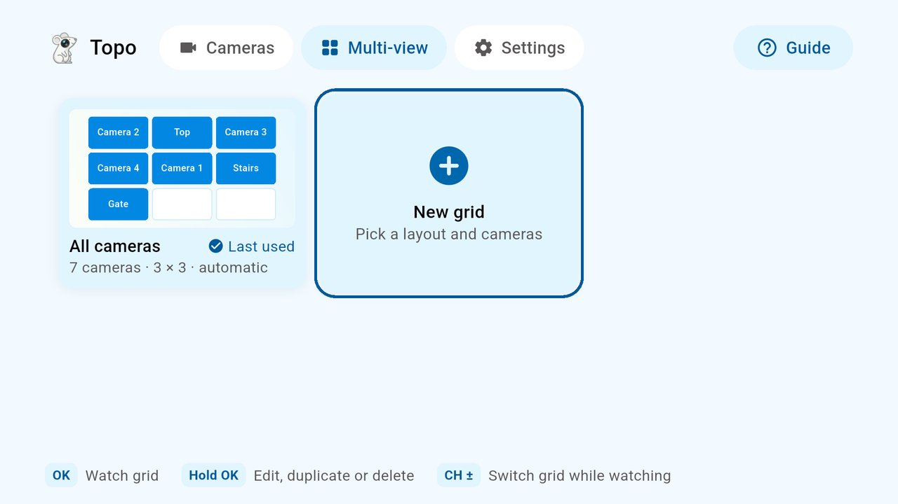
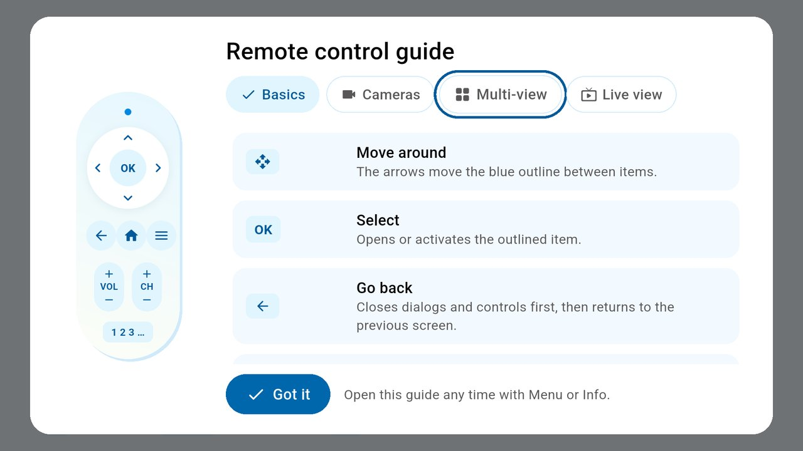
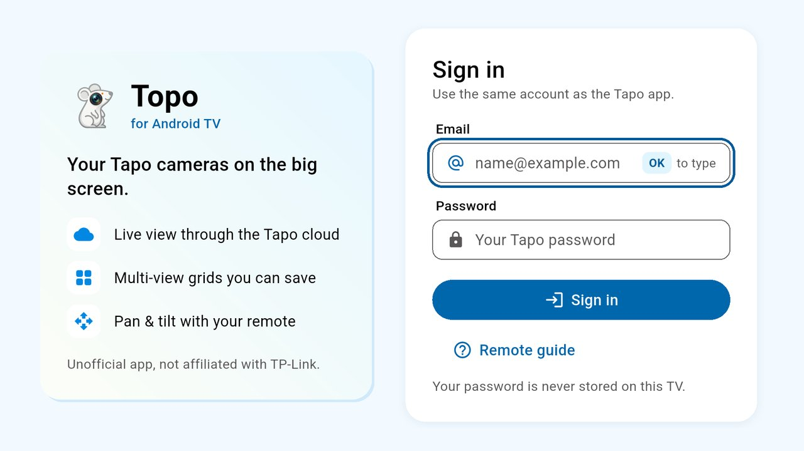
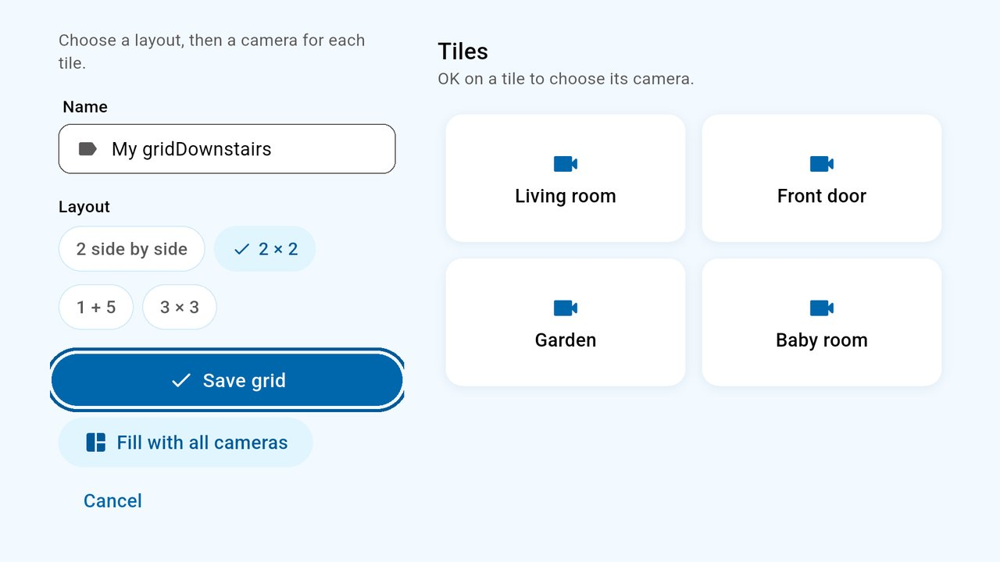
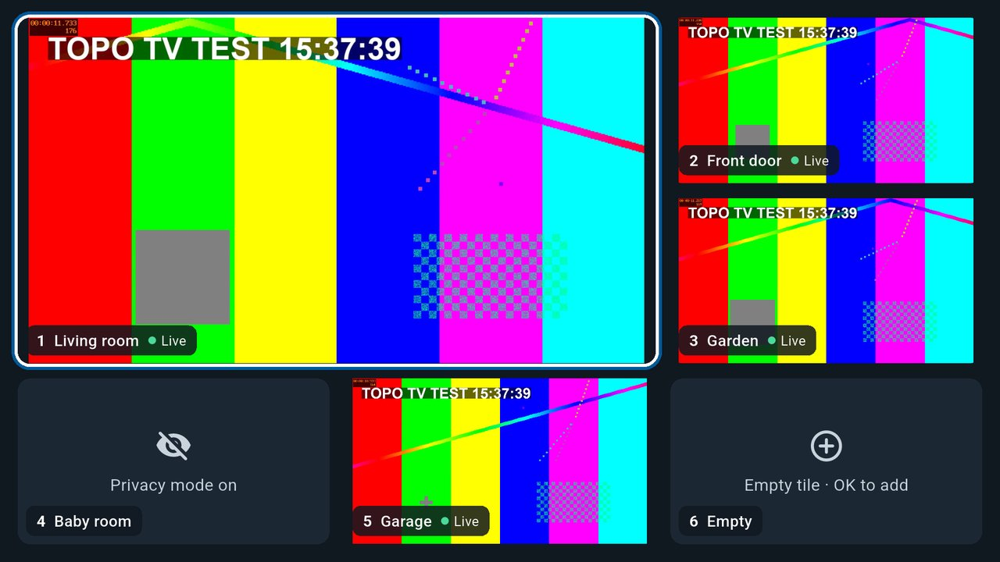
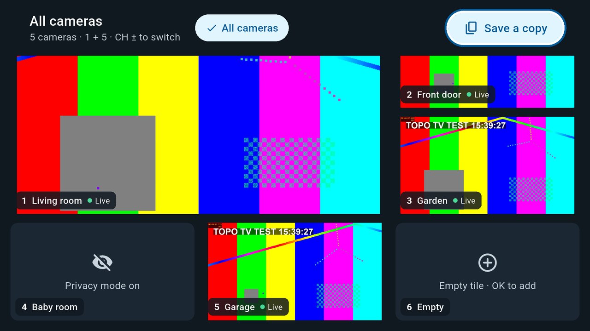

<p align="center">
  
</p>

<h1 align="center">Topo TV</h1>

<p align="center">
  <strong>Watch and control your Tapo cameras on Android TV, with nothing but the remote.</strong>
</p>

<p align="center">
  
  
  
  
  
  <a href="https://github.com/abdulmominsakib/tapo-android-tv/releases/latest"></a>
</p>

<p align="center">
  
</p>

Topo TV brings your Tapo cameras to the living room TV. Sign in with your Tapo
account and you get live previews of every camera, multi-camera grids, pan and
tilt on the D-pad, and privacy mode in one press. Everything goes through the
Tapo cloud, so you don't need RTSP, port forwarding, a VPN or to be on the same
network as the cameras.

It is an Android TV port of [Topo](https://github.com/filirnd/topo), the
Linux and Windows desktop app, rewritten in Flutter with a UI designed for the
remote from the ground up.

> [!IMPORTANT]
> Unofficial and experimental. Topo TV is not affiliated with TP-Link. It
> uses the same undocumented Tapo cloud endpoints as the desktop app, so it may
> stop working if Tapo changes them.

## Contents

- [Features](#features)
- [Screenshots](#screenshots)
- [Using the remote](#using-the-remote)
- [Install](#install)
- [Build from source](#build-from-source)
- [Design](#design)
- [How it works](#how-it-works)
- [Privacy and security](#privacy-and-security)
- [Status and limitations](#status-and-limitations)
- [Credits and licence](#credits-and-licence)

## Features

**Live video**
- Live previews of every camera on the home screen, started one at a time so
  slower TVs stay smooth
- The last captured picture of each camera appears instantly while its
  stream connects
- Full-screen live view with about 1 second of delay, reconnecting on its own
  if the stream drops
- Switch cameras with CH+/CH−, the number keys or on-screen buttons

**Multi-view grids**
- Watch several cameras at once: 2 side by side, 2 × 2, 1 + 5 or 3 × 3
- A built-in **All cameras** grid that always shows every camera
- Create, edit, duplicate and delete your own grids, saved on the TV
- Switch between grids with CH+/CH− or the grid bar
- Pin a **favourite grid** to the top of the home page and open it with one
  press

**Camera control**
- Pan and tilt with the arrow keys; hold an arrow to keep moving
- Choose how far each press moves the camera (5°, 10° or 20°)
- Turn privacy mode on or off

**Made for the TV**
- Everything works with the D-pad, OK and Back; no touch or pointer needed
- A clear blue outline shows where you are at all times
- Remote control guide on first launch, and any time from Menu / Info
- Sign in with MFA (Tapo app notification or email code), typing on the TV
  keyboard or from the Google TV app on your phone

## Screenshots

| | |
|---|---|
|  |  |
| **Cameras**: live previews of every camera | **Live view** full screen |
|  |  |
| **Multi-view**: built-in and saved grids | **Remote guide** lights up the keys for each action |
|  |  |
| **Sign in** with your Tapo account | **Grid editor**: a layout and a camera per tile |
|  |  |
| **Watching a grid** (1 + 5 layout) | **Grid bar**: switch grids or edit this one |

<p align="center"><em>The last four screenshots come from the built-in UI test mode, so their cameras show a test pattern.</em></p>

## Using the remote

| Where | Key | What it does |
|---|---|---|
| **Everywhere** | Arrows | Move the outline |
| | OK | Select |
| | Back | Close a dialog or controls, then go back |
| | Menu / Info | Open the remote guide |
| **Text boxes** | OK | Open the TV keyboard |
| **Cameras** | OK on the favourite grid | Watch the grid |
| | Hold OK on the favourite grid | Choose another grid or unpin it |
| | OK on a camera | Watch live |
| | Hold OK | Quick actions: privacy mode, reconnect |
| | 1–9 | Open camera 1 to 9 |
| **Multi-view** | OK | Watch the grid |
| | Hold OK | Pin to home, edit, duplicate or delete |
| **Watching a grid** | OK on a tile | That camera full screen |
| | Hold OK on a tile | Put a different camera in the tile |
| | Up from the top row | Grid bar: other grids, edit or save a copy |
| | CH+ / CH− | Next or previous grid |
| | 1–9 | Open tile 1 to 9 full screen |
| **Live view** | Arrows (controls hidden) | Pan and tilt; hold to keep moving |
| | OK | Show controls: privacy, step size, reconnect, guide, previous/next |
| | CH+ / CH−, ⏮ / ⏭, 1–9 | Switch camera |
| | ◀ ▶ | Switch camera (cameras without pan and tilt) |

Remotes without Menu, channel or number keys, like the Google TV remote,
can do everything with the on-screen buttons.

## Install

1. Download the latest `topo-tv-*.apk` from
   [Releases](https://github.com/abdulmominsakib/tapo-android-tv/releases/latest)
   (or build it yourself, see [Build from source](#build-from-source)).
2. Install it on the TV, from a USB drive with a file manager, or over the
   network with adb:

   ```bash
   adb connect <tv-ip-address>
   ```

   ```bash
   adb install -r app-release.apk
   ```

3. Open **Topo** from the TV's app list and sign in with your Tapo account.
   The first sign-in asks for a verification code once.

The release APK covers ARM, ARM64 and x86_64 devices. Android 7.0 (API 24)
or newer is required.

## Build from source

Requirements: [fvm](https://fvm.app) with Flutter **3.47.2**, the Android SDK
and JDK 17.

```bash
fvm install
```

```bash
fvm flutter pub get
```

```bash
fvm flutter build apk --release
```

The APK is written to `build/app/outputs/flutter-apk/app-release.apk`.

Run the tests (relay stream parser):

```bash
fvm flutter test
```

### Android TV emulator

The common **Android TV on x86** emulator image is 32-bit x86, which
Flutter doesn't support. It runs ARM apps through translation instead, so
build for ARM and install with adb (`flutter run` reports the device as
unsupported):

```bash
fvm flutter build apk --release --target-platform android-arm
```

```bash
adb install -r build/app/outputs/flutter-apk/app-release.apk
```

On emulators the player uses the software H.264 decoder, because the
emulator's hardware decoder stalls on live streams. Real TVs use hardware
decoding.

### UI test mode

To try the app without a Tapo account, build it with five fake cameras:

```bash
fvm flutter build apk --release --target-platform android-arm --dart-define=TOPO_DEMO=true
```

To get moving video in test mode, serve any live MPEG-TS stream on your
computer (for example ffmpeg's `testsrc2` sent over HTTP), forward the port
to the TV and add its URL:

```bash
adb reverse tcp:8099 tcp:8099
```

```bash
fvm flutter build apk --release --target-platform android-arm --dart-define=TOPO_DEMO=true --dart-define=TOPO_DEMO_STREAM=http://127.0.0.1:8099/live.ts
```

## Design

The interface follows a calm blue and white design system inspired by the Tapo
app, adapted for TV:

- White cards on a pale blue background, dark blue buttons
- A 3-unit dark blue focus outline with a small gap, plus a slight zoom; over
  video it gets a white inner edge so it stays visible
- Focus, selection and pressed states all look different, and moving the
  outline never triggers an action by itself
- Large text for viewing from the sofa, on a 960 × 540 layout grid with
  overscan-safe margins
- Video screens keep a dark backdrop behind their controls

Design tokens are in [`lib/ui/theme.dart`](lib/ui/theme.dart) and the
remote-friendly components in [`lib/ui/tv.dart`](lib/ui/tv.dart).

## How it works

```
Tapo cloud ──HTTPS──▶ TapoCloud (Dart) ──▶ RelayBridge on 127.0.0.1 ──▶ ExoPlayer view
  login, MFA,           signed API,           plain MPEG-TS,               low-latency
  cameras, control      CIPC relay parser     per-launch secret            playback
```

| Part | File |
|---|---|
| Tapo cloud client: signed account API, MFA, camera list, privacy, pan and tilt, CIPC video relay | [`lib/api/tapo_cloud.dart`](lib/api/tapo_cloud.dart) |
| Local bridge that hands each relay to the player as plain MPEG-TS | [`lib/api/relay_bridge.dart`](lib/api/relay_bridge.dart) |
| Native player: ExoPlayer (media3) with small buffers and catch-up speed | [`android/.../LivePlayer.kt`](android/app/src/main/kotlin/io/github/topo/topo_tv/LivePlayer.kt) |
| App state, session and settings | [`lib/state/app_state.dart`](lib/state/app_state.dart) |
| Grid layouts and saved grids | [`lib/state/grids.dart`](lib/state/grids.dart) |
| Screens: sign-in, cameras, multi-view, live view, settings | [`lib/screens/`](lib/screens) |
| Remote guide | [`lib/ui/guide.dart`](lib/ui/guide.dart) |

The cloud client is a Dart port of the desktop app's
[`tapo_cloud_probe.py`](https://github.com/filirnd/topo/blob/main/tapo_cloud_probe.py)
and the relay handling in `tapo_cloud_app.py`. The video is embedded as a
native Android view that never takes focus, so the remote always controls the
Flutter UI.

## Privacy and security

- **Your password is never stored.** Only the Tapo session token is saved, in
  the app's private storage. **Settings → Sign out** removes it.
- **TLS checks stay on.** The two TP-Link root certificates that ship with the
  official Tapo app ([`assets/tapo-cloud-roots.pem`](assets/tapo-cloud-roots.pem))
  are added to the system's trusted roots; nothing is bypassed.
- **Video stays on the TV.** The local bridge only listens on `127.0.0.1`,
  and every stream URL carries a random key created at launch, so other apps
  on the TV can't read it.
- The app only talks to the Tapo cloud. It never connects to your home
  network or the cameras directly.

## Status and limitations

- Tested with a real Tapo account and seven cameras, including
  C200 and C202 models: sign-in
  with MFA, live previews, multi-view, pan and tilt, and privacy mode. Reports
  for other models are welcome (model, firmware and what works).
- Video only, no audio or two-way talk yet.
- No recordings, snapshots or motion notifications yet.
- Cameras that send encrypted video aren't supported yet; the app says so
  when it meets one.
- Pan and tilt only work on cameras that support it.
- Needs an internet connection and a Tapo account.

## Credits and licence

Topo TV is based on [Topo](https://github.com/filirnd/topo) by filirnd,
including its Tapo cloud research, and is released under the
[MIT License](LICENSE). The Topo TV logo (a TV screen with a camera lens) was made for this port. Tapo and TP-Link are trademarks of TP-Link; this
project is not endorsed by or affiliated with them.
